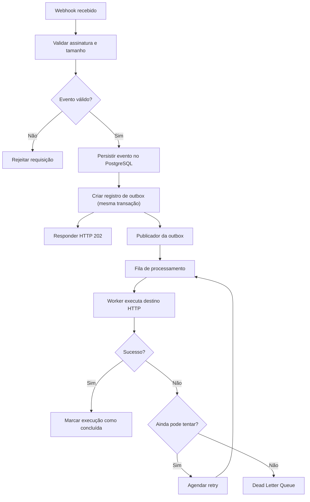

# FlowLedger — Briefing de Projeto (Time de Engenharia Sênior)

> **Webhook infrastructure for modern SaaS applications.**
> Receber eventos, entregar com retentativas e mostrar exatamente o que aconteceu.

| Item | Valor |
| --- | --- |
| Versão do documento | 1.0 (rascunho para kickoff) |
| Data | 08/11/2026 |
| Tipo | Produto B2B de infraestrutura (developer-facing) |
| Horizonte do MVP | 12 semanas |
| Orçamento inicial | ~R$ 1.500 (estimativa de planejamento) |
| Status | Pré-desenvolvimento |

---

## 1. Resumo executivo

O FlowLedger é uma plataforma que **recebe eventos HTTP de sistemas externos, persiste-os com segurança, entrega-os a destinos HTTP configurados com retry automático e oferece rastreabilidade completa** de cada execução (ID, etapas, entradas, saídas, duração, tentativas e falhas).

A visão de longo prazo é uma plataforma de orquestração e rastreabilidade de processos entre sistemas (vendas, ERP, pagamentos, e-mail, APIs próprias). **O MVP, porém, é deliberadamente estreito:** um excelente motor de entrega de webhooks com observabilidade. O editor visual de workflows e as integrações prontas ficam para depois da validação comercial.

**Por que este projeto:**

- Problema real e recorrente: webhooks e tarefas assíncronas são frágeis em quase todo SaaS.
- Desafios de engenharia genuínos: processamento assíncrono, consistência, idempotência, multi-tenancy, observabilidade, segurança de saída (SSRF).
- Potencial de produto internacional (API simples, documentação, SDKs).

**Meta de validação do MVP:** conquistar **5 empresas** usando o produto e descobrir se pagariam para continuar.

---

## 2. Problema, público e posicionamento

### 2.1 Problema

Empresas integram vários sistemas. Quando um evento ocorre (ex.: pagamento aprovado), é preciso atualizar pedido, notificar cliente e sincronizar financeiro. Hoje isso costuma ser feito com código ad hoc, sem garantia de entrega, sem reprocessamento e sem visibilidade do que aconteceu.

### 2.2 Público-alvo inicial

| Público | Dor principal |
| --- | --- |
| Software houses | Integrações difíceis de manter |
| SaaS B2B | Webhooks e tarefas assíncronas |
| E-commerce | Sincronização de pedidos |
| Equipes de engenharia | Falta de rastreabilidade |
| Empresas com ERP | Processos entre sistemas |

**Nicho de entrada:** pequenas software houses, empresas SaaS e times de tecnologia que integram múltiplos sistemas.

### 2.3 Posicionamento

*Reliable webhook delivery and execution monitoring for SaaS teams.*

Não competimos de frente com plataformas generalistas de automação. Competimos em **confiabilidade, clareza de histórico e experiência de desenvolvedor**.

### 2.4 Diferenciais

- API simples e documentação excelente.
- Histórico detalhado de cada entrega.
- Retentativas configuráveis.
- Reprocessamento sem duplicação de efeitos quando o destino suporta idempotência.
- SDK Python primeiro; depois TypeScript e Go.
- Dashboard em inglês e português.
- Datas em UTC; infraestrutura preparada para múltiplas regiões.

---

## 3. Escopo do MVP

### 3.1 Módulos

| Módulo | Responsabilidade |
| --- | --- |
| **1. Webhook Gateway** | Receber eventos HTTP, validar assinatura e tamanho, persistir e responder rápido. |
| **2. Execution Engine** | Processar em background, executar chamadas HTTP aos destinos, controlar tentativas, classificar falhas, DLQ. |
| **3. Observability Dashboard** | Exibir eventos, execuções, erros, duração, histórico e permitir reprocessamento manual. |

### 3.2 Funcionalidades

| Funcionalidade | Prioridade |
| --- | --- |
| Cadastro e autenticação | Essencial |
| Organizações e projetos | Essencial |
| API Keys | Essencial |
| Endpoint de recebimento de webhooks | Essencial |
| Persistência dos eventos | Essencial |
| Processamento assíncrono | Essencial |
| Configuração de destinos HTTP | Essencial |
| Retry automático | Essencial |
| Idempotência | Essencial |
| Histórico de execução | Essencial |
| Dashboard de monitoramento | Essencial |
| Dead Letter Queue | Essencial |
| Reprocessamento manual | Essencial |
| Editor visual de workflows | Futuro |
| Integrações prontas com ERP | Futuro |
| Inteligência artificial | Futuro |

### 3.3 Fora de escopo (explícito)

- Editor visual de automações.
- Dezenas de integrações nativas.
- Kubernetes.
- Microservices.
- IA "porque está em alta".
- Meses de polimento do dashboard.
- Otimização para milhões de eventos antes dos primeiros clientes.

---

## 4. Garantias do sistema (contrato de engenharia)

Estas garantias são o centro técnico do produto e devem guiar todas as decisões.

| Garantia | Descrição |
| --- | --- |
| **Durabilidade na ingestão** | Um evento com resposta `202` nunca é perdido, mesmo que Redis/broker estejam indisponíveis. |
| **Entrega at-least-once** | Não prometemos exactly-once. Um destino pode receber e processar a requisição e a resposta se perder. |
| **Identificador estável de entrega** | Cada entrega carrega um ID de idempotência estável entre tentativas e reprocessamentos, para o destino deduplicar. |
| **Idempotência na ingestão** | Reenvio do mesmo evento pelo remetente não gera processamentos duplicados (unique por projeto). |
| **Histórico imutável** | Tentativas nunca são sobrescritas; cada uma é um registro novo. |
| **Isolamento entre tenants** | Nenhum dado de uma organização é acessível por outra. |
| **Semântica do `202`** | Significa "aceito para processamento", não "entregue". Deve estar documentado na API. |

---

## 5. Arquitetura

### 5.1 Princípios

- **Monólito modular** com **workers independentes**. Sem microservices no início, mas com fronteiras de módulo que permitam separação futura.
- Cada módulo é dono do seu domínio, regras e casos de uso. **Nenhuma lógica de negócio nos endpoints FastAPI.**
- Comunicação entre módulos via interfaces explícitas e eventos internos.

### 5.2 Fluxo de ponta a ponta



### 5.3 Transactional Outbox

**Problema:** salvar o evento no banco e depois publicar no Redis deixa uma janela de falha em que o evento existe mas nunca entra na fila.

**Solução:** gravar o evento **e** a mensagem de outbox na **mesma transação PostgreSQL**. Um processo independente (publisher) lê mensagens pendentes e publica na fila, marcando-as como publicadas. Isso elimina a necessidade de transação distribuída banco + broker.

Requisitos do publisher:

- Seleção concorrente-segura (`SELECT ... FOR UPDATE SKIP LOCKED`).
- Publicação idempotente (o consumidor tolera duplicatas de mensagem).
- Métrica de lag da outbox (idade da mensagem pendente mais antiga) com alerta.
- Limpeza/arquivamento de mensagens antigas.

### 5.4 Estrutura de repositório sugerida

```text
flowledger/
├── apps/
│   ├── api/                # main.py, dependencies.py, middleware.py
│   ├── modules/
│   │   ├── identity/
│   │   ├── organizations/
│   │   ├── projects/
│   │   ├── webhooks/
│   │   ├── destinations/
│   │   ├── executions/
│   │   ├── retries/
│   │   └── audit/
│   ├── workers/
│   │   ├── tasks/
│   │   └── scheduler/
│   ├── shared/
│   │   ├── database/
│   │   ├── security/
│   │   ├── events/
│   │   └── observability/
│   └── config/
├── migrations/
├── tests/
│   ├── unit/
│   ├── integration/
│   └── e2e/
├── docker/
├── docker-compose.yml
└── pyproject.toml
```

---

## 6. Stack tecnológica

| Camada | Tecnologia |
| --- | --- |
| Backend | Python 3.13+ / FastAPI |
| Validação | Pydantic |
| ORM | SQLAlchemy 2 |
| Banco | PostgreSQL |
| Migrations | Alembic |
| Filas | Celery + Redis |
| Frontend | Next.js + TypeScript |
| Autenticação | JWT + refresh tokens |
| Testes | Pytest |
| Infraestrutura | Docker |
| CI/CD | GitHub Actions |
| Observabilidade | OpenTelemetry |
| Erros | Sentry |
| Storage | S3 compatível |

**Nota:** Celery + Redis bastam para começar. Se a complexidade das execuções crescer, avaliar RabbitMQ ou Temporal (ver ADR-002 na seção 15).

---

## 7. Modelo de dados

### 7.1 Modelo conceitual

`Organization` (tenant) → `Users` (via `Memberships`) → `Projects` → `Webhook Endpoints`, `Destinations`, `Events` → `Executions` → `Execution Attempts`.

### 7.2 Tabelas principais

| Tabela | Campos importantes |
| --- | --- |
| `organizations` | id, name, slug, created_at |
| `users` | id, email, password_hash |
| `memberships` | organization_id, user_id, role |
| `projects` | id, organization_id, name |
| `api_keys` | id, project_id, key_hash, expires_at |
| `webhook_endpoints` | id, project_id, signing_secret |
| `events` | id, project_id, event_type, payload, status |
| `destinations` | id, project_id, url, enabled |
| `executions` | id, event_id, destination_id, status |
| `execution_attempts` | id, execution_id, attempt_number, response_code |
| `audit_logs` | id, organization_id, actor_id, action |

Tabela adicional necessária pelo padrão escolhido: `outbox_messages` (id, aggregate_id, topic, payload, created_at, published_at, ...).

### 7.3 Constraints e decisões

1. **Multi-tenancy:** toda entidade de cliente tem escopo de organização ou projeto. Combinar constraints, autorização no backend e, quando apropriado, **PostgreSQL Row Level Security**.
2. **Idempotência:** constraint `UNIQUE (project_id, idempotency_key)` em `events`.
3. **Histórico imutável:** `execution_attempts` é append-only (sem UPDATE/DELETE pela aplicação).
4. **Payloads grandes:** começar no PostgreSQL com limite de tamanho; migrar para object storage (S3 compatível) quando o volume justificar.
5. **Segredos:** API keys apenas como hash; signing secrets protegidos (ex.: criptografia em repouso).
6. **Índices a desenhar desde o início:** listagens por projeto + status + data, lookup por idempotency key, fila de retries por `next_attempt_at`, outbox pendente. Validar com `EXPLAIN` em testes de carga.
7. **Retenção:** definir política (por plano) de expurgo de payloads e tentativas, já que dados crescem rápido.

---

## 8. Processamento confiável

### 8.1 Estados (proposta)

**Event:** `received → queued → completed | partially_failed | failed`

**Execution:** `pending → in_progress → succeeded | retry_scheduled → ... → dead_lettered`

Transições devem ser validadas no domínio (state machine explícita) e cobertas por testes.

### 8.2 Estratégia de retry

Backoff exponencial com jitter:

```text
delay_n = min(30 * 2^(n-1), 3600) + jitter
```

| Tentativa | Atraso aproximado |
| --- | --- |
| 1ª | Imediata |
| 2ª | ~30 s |
| 3ª | ~60 s |
| 4ª | ~120 s |
| Seguintes | Crescente, teto de 1 hora |

Todos os valores são **configuráveis**. Também implementar **timeout por destino** e **classificação de erros**:

| Resposta | Classificação |
| --- | --- |
| HTTP 2xx | Sucesso |
| HTTP 400 (e 4xx em geral) | Normalmente falha permanente |
| HTTP 429 | Temporária; respeitar `Retry-After` |
| HTTP 5xx | Normalmente temporária |
| Timeout / erro de rede | Temporária |

### 8.3 Dead Letter Queue e reprocessamento

- Esgotadas as tentativas, a execução vai para DLQ (estado `dead_lettered`, visível no dashboard).
- Reprocessamento manual cria **novas tentativas** na mesma execução (ou nova execução vinculada), **preservando o ID estável de idempotência** da entrega.
- Reprocessamento deve ser auditado (`audit_logs`).

### 8.4 Pontos de atenção técnicos

- **Retries duráveis:** agendar retry apenas via `countdown` do Celery depende do broker. Avaliar manter `next_attempt_at` no PostgreSQL e um scheduler que re-enfileira (ver ADR-003).
- **Visibilidade/ack do Redis:** configurar `acks_late`, visibility timeout e idempotência do worker para tolerar redelivery.
- **Concorrência por destino:** limitar paralelismo por destino para não derrubar o cliente (e evitar head-of-line blocking de um destino lento sobre os demais).
- **Ordenação:** não prometer ordenação global. Se for requisito futuro, tratar como feature explícita.

---

## 9. API pública (v1)

| Método | Endpoint | Responsabilidade |
| --- | --- | --- |
| POST | `/v1/events` | Receber evento |
| GET | `/v1/events` | Listar eventos |
| GET | `/v1/events/{id}` | Consultar evento |
| POST | `/v1/destinations` | Criar destino |
| GET | `/v1/destinations` | Listar destinos |
| PATCH | `/v1/destinations/{id}` | Atualizar destino |
| GET | `/v1/executions` | Consultar execuções |
| GET | `/v1/executions/{id}` | Detalhar execução |
| POST | `/v1/executions/{id}/retry` | Reprocessar execução |
| GET | `/v1/usage` | Consultar consumo |

**Exemplo de requisição**

```json
{
  "event_type": "payment.approved",
  "idempotency_key": "payment-123",
  "payload": {
    "payment_id": "123",
    "amount": 199.90,
    "currency": "BRL"
  }
}
```

**Exemplo de resposta (`202 Accepted`)**

```json
{
  "event_id": "evt_01ABC",
  "status": "accepted",
  "received_at": "2026-11-08T12:00:00Z"
}
```

**Requisitos de API a fechar:** paginação por cursor, formato padronizado de erros, rate limit headers, versionamento, contrato OpenAPI como fonte de verdade, e definição de como `POST /v1/events` (API key) e os endpoints de webhook com `signing_secret` (remetentes externos) coexistem como duas portas de entrada.

---

## 10. Segurança

- API keys **nunca** em texto puro (apenas hash; exibir a chave completa uma única vez).
- Proteção dos signing secrets; **validação de assinatura** de webhooks (com proteção contra replay via timestamp, quando aplicável).
- **Rate limiting** por projeto/chave.
- **Proteção contra SSRF** nas chamadas de saída: bloquear IPs internos/privados/link-local/metadata de cloud, validar resolução de DNS (anti-rebinding), tratar **redirecionamentos** e restringir esquemas/portas.
- Assinar as entregas de saída (para o destino validar a origem).
- **Não registrar** tokens ou dados sensíveis em logs; mascarar headers de autorização.
- Autorização em toda rota com escopo de organização/projeto; testes dedicados de isolamento.
- Senhas com hash adequado (argon2/bcrypt); refresh tokens com rotação e revogação.
- Auditoria de ações administrativas em `audit_logs`.

---

## 11. Observabilidade e operação

| Área | Itens |
| --- | --- |
| **Tracing** | OpenTelemetry com trace propagado: ingestão → outbox → fila → worker → destino. |
| **Métricas** | Taxa de ingestão, latência do `202`, lag da outbox, profundidade das filas, taxa de sucesso/falha por destino, duração de entregas, tamanho da DLQ. |
| **Logs** | Estruturados, com `event_id`, `execution_id`, `project_id` (sem dados sensíveis). |
| **Erros** | Sentry. |
| **Alertas** | Lag de outbox, fila crescendo, taxa de erro anômala, falha de backup. |
| **Backups** | Rotina automatizada e **teste de restauração** documentado. |

---

## 12. Requisitos não funcionais (alvos propostos, a calibrar)

> Números abaixo são **hipóteses de partida** para discussão, não compromissos. Devem ser validados em teste de carga.

| Requisito | Alvo inicial sugerido |
| --- | --- |
| Latência de ingestão (p95) | Baixa o bastante para o remetente nunca dar timeout; definir meta numérica após baseline |
| Perda de eventos aceitos (`202`) | Zero |
| Disponibilidade da ingestão | Definir SLO após beta |
| Tamanho máximo de payload | Limite configurável por plano |
| Retenção | Definida por plano |
| Recuperação | RPO/RTO a definir junto com a estratégia de backup |

---

## 13. Estratégia de testes

| Nível | Foco |
| --- | --- |
| **Unitário** | Regras de domínio, state machines, classificação de erros, cálculo de backoff. |
| **Integração** | PostgreSQL real (containers), outbox, idempotência (inclusive concorrência), Celery. |
| **E2E** | Webhook → entrega → retry → DLQ → reprocessamento. |
| **Segurança** | Isolamento multi-tenant, SSRF (IPs internos, redirects, DNS rebinding), validação de assinatura. |
| **Caos/falha** | Redis fora do ar, destino lento/indisponível, worker morto no meio da entrega, publisher da outbox reiniciado. |
| **Carga** | Throughput de ingestão, comportamento sob destino lento, crescimento de tabelas e plano de índices. |

CI (GitHub Actions) com lint, type-check, testes e build de imagem a cada PR.

---

## 14. Roadmap — 12 semanas

Ciclos de 2 semanas, cada um com entrega demonstrável.

| Semanas | Fase | Principais entregas | Resultado demonstrável |
| --- | --- | --- | --- |
| 1–2 | **Foundation** | Repositório, FastAPI, PostgreSQL + Alembic, arquitetura modular, organizações/usuários/autenticação, testes e CI | API funcional |
| 3–4 | **Webhook Gateway** | Endpoints de entrada, validação de assinatura, idempotência, persistência, Transactional Outbox | Ingestão confiável |
| 5–6 | **Execution Engine** | Celery + Redis, workers, destinos HTTP, timeout, retry, DLQ, reprocessamento | Motor de processamento |
| 7–8 | **Dashboard** | Frontend, listagem de eventos, visualização de payloads, tentativas, filtro de falhas, configurações | Produto utilizável |
| 9–10 | **Production readiness** | Testes de carga, testes de isolamento, rate limiting, observabilidade, alertas, backup e recuperação | Beta de produção |
| 11–12 | **Lançamento** | Documentação, SDK Python, exemplos, landing page, cadastro beta, conversas com clientes | Primeiro lançamento público |

**Sugestão de Definition of Done por fase:** código revisado, testes automatizados passando em CI, migrations reversíveis, documentação mínima atualizada, métricas/logs do que foi entregue e ADR para decisões relevantes.

---

## 15. Decisões de arquitetura a registrar (ADRs)

| ADR | Tema | Pergunta/decisão |
| --- | --- | --- |
| 001 | Monólito modular | Fronteiras de módulo e regras de dependência. |
| 002 | Broker | Celery + Redis agora; critérios de gatilho para RabbitMQ/Temporal. |
| 003 | Retries | `countdown` do broker vs. `next_attempt_at` no PostgreSQL com scheduler. |
| 004 | Multi-tenancy | Escopo por coluna + RLS: onde aplicar e como testar. |
| 005 | Entrada de eventos | Coexistência de `POST /v1/events` (API key) e endpoints de webhook com assinatura. |
| 006 | Payloads | Limite de tamanho e gatilho para mover a object storage. |
| 007 | Retenção | Política de expurgo e particionamento de `events`/`execution_attempts`. |
| 008 | Segredos | Armazenamento e rotação de signing secrets e chaves. |
| 009 | Garantia de entrega | Formalizar at-least-once e o contrato de idempotência com os destinos. |

---

## 16. Riscos e mitigações

| Risco | Impacto | Mitigação |
| --- | --- | --- |
| Perda de evento entre banco e fila | Crítico | Transactional Outbox + monitoramento de lag. |
| Entrega duplicada percebida como bug | Alto | Documentar at-least-once; ID de idempotência estável; SDK/exemplos de deduplicação. |
| SSRF via URL de destino | Crítico | Validação de IP/DNS/redirect; testes dedicados; rede de saída restrita. |
| Vazamento entre tenants | Crítico | Escopo em todas as queries, RLS, testes automatizados de isolamento. |
| Destino lento prejudica outros clientes | Alto | Timeouts, limites de concorrência por destino, filas/prioridades. |
| Crescimento de dados (payloads/tentativas) | Médio | Limites, retenção por plano, plano de migração para object storage. |
| Overengineering | Médio | Escopo do MVP fechado; seção 3.3 como guarda-corpo. |
| Falta de validação comercial | Alto | Conversas com clientes desde as semanas 9–12; meta de 5 empresas. |
| Custos por evento maiores que o preço | Médio | Modelar custo por evento, armazenamento, tráfego e retenção antes de fixar planos. |

---

## 17. Negócio

### 17.1 Modelo de monetização (hipóteses a validar)

| Plano | Preço hipotético | Volume |
| --- | --- | --- |
| Free | US$ 0 | 5 mil eventos |
| Starter | US$ 19/mês | 50 mil eventos |
| Growth | US$ 49/mês | 250 mil eventos |
| Pro | US$ 99/mês | 1 milhão de eventos |

Limites e preços são **hipóteses**. É obrigatório calcular custo por evento, armazenamento, tráfego e retenção antes de oferecer os planos.

### 17.2 Orçamento inicial (estimativa para planejamento)

| Item | Valor |
| --- | --- |
| Domínio | R$ 80 |
| VPS / hospedagem inicial | R$ 250 |
| Banco e backups | R$ 150 |
| Serviços auxiliares | R$ 100 |
| Landing page e identidade | R$ 100 |
| Reserva operacional | R$ 820 |
| **Total** | **R$ 1.500** |

Valores estimados, não cotações. Priorizar planos gratuitos e não contratar infraestrutura antes de precisar.

---

## 18. Critérios de sucesso

**Técnicos**

- Zero perda de eventos aceitos nos testes de falha (Redis down, worker morto, publisher reiniciado).
- Idempotência comprovada sob concorrência.
- Isolamento multi-tenant coberto por testes automatizados.
- Toda entrega rastreável de ponta a ponta (trace + histórico de tentativas).
- Rotina de backup com restauração testada.

**De produto**

- 5 empresas usando o produto.
- Feedback qualitativo sobre disposição a pagar.
- Documentação e SDK Python suficientes para integrar sem suporte direto.

**De portfólio/engenharia**

ADRs publicados, migrations e índices bem justificados, testes de carga documentados, e um repositório que demonstre arquitetura, confiabilidade, segurança e operação.

---

## 19. Primeiro sprint (início imediato)

1. Criar o repositório `flowledger` com estrutura modular, `pyproject.toml`, Docker Compose (API, PostgreSQL, Redis) e pipeline de CI.
2. Configurar FastAPI, PostgreSQL, SQLAlchemy 2 e Alembic.
3. Modelar `Organization`, `Project` e `WebhookEndpoint`.
4. Implementar autenticação (JWT + refresh tokens).
5. Criar o primeiro endpoint de recebimento de eventos.
6. Escrever testes de integração (incluindo um teste inicial de isolamento entre tenants).
7. Abrir ADR-001 (monólito modular) e ADR-005 (entrada de eventos).

**Próximo passo sugerido:** desenhar o schema PostgreSQL completo (SQLAlchemy 2, relacionamentos, índices, constraints e migrations) e o esqueleto do projeto FastAPI.

---

## 20. Princípio orientador

Não construir o FlowLedger apenas para conseguir emprego: construir para resolver um problema real. Se virar negócio, ótimo; se não, o time terá experiência concreta em sistemas distribuídos, arquitetura e operação de software. **O melhor resultado é construir algo que as pessoas usem porque precisam.**
